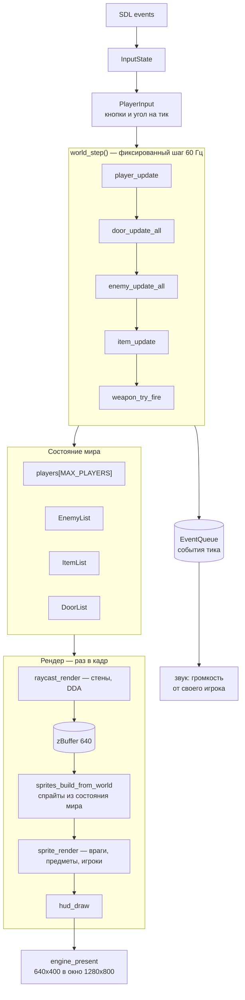

# Устройство игры

Как doom-clone работает **сейчас** и почему сделан именно так. Куда проект
движется — в [roadmap.md](roadmap.md); что делать конкретно — в
[tasks/](tasks/); нефункциональные ограничения — в
[requirements.md](requirements.md).

Сборка, управление, формат карты и структура каталогов описаны в
[../README.md](../README.md) и здесь не повторяются. Ловушки, о которых
стоит знать до правки кода, — в [../CLAUDE.md](../CLAUDE.md).

Игра прошла четыре этапа разработки: базовый движок с raycasting, текстуры
и спрайты, стрельба и ИИ, HUD со звуком и состояниями игры. Всё это
работает; дальше идёт мультиплеер.

## Технологии

| Что | Чем |
|---|---|
| Язык | C11 (gcc / clang / MSVC) |
| Сборка | CMake, кросс-платформенная |
| Графика и ввод | SDL2 |
| Звук | SDL2_mixer |
| Загрузка изображений | stb_image (`vendor/`) — в `assets_load_png()`, через неё `assets_load_sheet()` грузит листы кадров |
| Рендер | программный raycasting (DDA) |

Буфер кадра 640×400 растягивается в окно 1280×800. Ни GPU, ни звуковая
карта не требуются: рендер целиком на CPU, SDL нужен только чтобы показать
готовый кадр.

## Как устроен кадр

Стрелок из рендера обратно в состояние мира нет: список спрайтов клиент
собирает из мира заново каждый кадр, а мир о списке не знает.

## Настройки игры

Источник истины — `src/config.h` для лимитов, тикрейта и сетевых констант и
`src/utils.h` для всего остального; таблица здесь для ориентира.

| Параметр | Значение |
|---|---|
| FOV | 77° по горизонтали (`FOV_PLANE 0.8` при длине направления 1.0) |
| Скорость движения | 3.0 клетки/с |
| Скорость поворота | 3.0 рад/с |
| Чувствительность мыши | 0.002 рад/px |
| Радиус игрока | 0.2 клетки |
| Шаг симуляции | 60 Гц, фиксированный |
| Размер карты | до 48×48 (`MAP_MAX_W/H`), каков файл: ширина — самая длинная строка, высота — число строк |

## Рендер

Классический raycasting по мотивам туториала lodev. На каждый из 640
экранных столбцов выпускается луч, DDA идёт по сетке карты до первой стены
или закрытой двери, дальше столбец текстурируется по вертикали. Шагов у
трассы не больше `MAP_MAX_W + MAP_MAX_H` (`raycast_world.c`): каждый шаг
пересекает одну линию сетки, и прямая изнутри карты пересекает каждый
столбец и каждую строку не больше раза, прежде чем выйти за край, где
`map_cell()` — стена. Поэтому ни луч, ни `world_line_of_sight()` не
обрываются раньше стены, какой бы большой ни была карта.

Сам DDA живёт отдельно от рендера — `raycast_walls()` в
`raycast_world.c`, который не знает ни про экран, ни про SDL и возвращает
`RayHit` с перпендикулярной дистанцией, точкой попадания, гранью и клеткой.
`raycast_render()` отвечает только за текстурирование, затенение сторон и
`zBuffer`. Той же трассировкой ИИ проверяет линию видимости.

Три вещи, которые здесь принципиальны:

1. **Коррекция «рыбьего глаза».** Расстояние берётся перпендикулярное
   (`perpWallDist`), а не евклидово до точки попадания. С евклидовым стены
   выгибаются к краям экрана.
2. **Z-буфер обязателен.** `float zBuffer[SCREEN_W]` заполняется при
   отрисовке стен и проверяется по столбцам при отрисовке спрайтов —
   иначе спрайты рисуются поверх стен, за которыми стоят.
3. **Спрайты сортируются от дальних к ближним** и рисуются в этом порядке,
   чтобы ближние перекрывали дальние.

Сам список спрайтов — вещь клиентская: `sprites_build_from_world()`
(`sprite.c`) собирает его заново каждый кадр из состояния мира, у сетевого
клиента — из вида с чужими игроками в прошлом (раздел «Клиент»): живые
враги и трупы, ещё не подобранные предметы, бочки с карты и все игроки,
кроме своего, мёртвые тоже. Ни одна сущность симуляции спрайта не держит,
поэтому выделенному серверу список не нужен вовсе, а сортировка и Z-буфер
работают ровно так же, как раньше: поменялся источник данных, а не рендер.

### Персонажи и анимация

Враги и чужие игроки — одни и те же персонажи: каталоги
`assets/players/<скин>/` с листом на каждую анимацию `AnimId` — стойка,
бег, выстрел, боль, смерть. Номер скина — строка в
`assets/players/skins.txt`. Игроку он равен `id`: сервер раздаёт слоты так,
что в матче они не повторяются, каждый клиент читает один и тот же `id` из
снапшота, а смерть его не меняет. Выходит десять разных персонажей, иначе в
свалке из десяти человек никого не различить, и каждый выглядит одинаково
на всех клиентах — пока скинов не меньше, чем слотов (`_Static_assert` в
`config.h`). Врагу номер даёт клиентская таблица по `EnemyType` в
`sprite.c`: имп — `marine`, сержант — `swat`. Имена разрешаются в номера
один раз, симуляция о скинах не знает. Строка листа выбирается по ракурсу:
разница между углом игрока и направлением на камеру даёт один из четырёх
видов (анфас, спина, два профиля). В deathmatch это не косметика — по
спрайту без ракурса не понять, заметил тебя противник или нет. Пока в
листах по одной строке, ракурсы появятся с заменой картинок.

Анимация целиком клиентская и в тик не входит. Скорости, факта урона и
факта выстрела в мире нет, и симуляция не заводит их ради картинки — клиент
выводит всё это сам, сравнивая этот кадр с прошлым. `SpriteAnim`
(`sprite.h`) держит запись на каждый `id` игрока и врага: текущую анимацию,
её фазу и то, что видел прошлый кадр, — позицию, здоровье и то, что
выстрел взводит заново: `Weapon.anim` оружия в руках у игрока,
`attack_cooldown` у врага. `sprite_anim_update()` раз в кадр проверяет
правила по порядку, первое сработавшее побеждает:

1. мёртв (`ESTATE_DEAD`, `!alive`) — смерть;
2. здоровье упало — боль, на фиксированное время;
3. выстрелил или целится — выстрел: вспышка на `WEAPON_SHOT_TIME` после
   выстрела, а враг в `ESTATE_ATTACK` между выстрелами стоит на первом
   кадре листа, в прицеле;
4. сдвинулся — бег, и ещё `ANIM_RUN_HOLD` после последнего сдвига;
5. иначе — стойка.

Выдержка бега нужна потому, что позиция меняется не каждый кадр: выше
тикрейта в кадре без тика сдвиг нулевой. Смена анимации сбрасывает фазу;
смерть не зациклена и остаётся на последнем кадре, поэтому труп — тот же
персонаж в смерти, а не отдельный лист. Фаза живёт по идентификатору, а не в `Sprite`, который
пересобирается каждый кадр: вышедший из поля зрения продолжает свою
анимацию. Скорости — константы в `sprite.c`. Вспышка, как и боль,
отсчитывается часами клиента от момента, который он заметил, а не берётся
из мира: выстрел, убивший игрока, останавливает мир, а вспышка у стрелявшего
доигрывает. Начало же берётся из мира, а не из входа в `ESTATE_ATTACK`:
враг, вернувшийся в атаку с недоперезаряженным оружием, стреляет не сразу.
На паузе часы стоят, после смерти игрока и победы — доигрывают.

Оружие в руках выбирает кадр по `Weapon.anim`: он гаснет от 1 до 0 за
`WEAPON_SHOT_TIME` (`weapon.h`), одинаковое для любого оружия, — это
вспышка у ствола, а не перезарядка. Растянутая на `fire_cd` медленного
оружия, она шла бы как в замедленной съёмке; остаток перезарядки оружие
стоит на нулевом кадре, в покое.

Статус-бар — плашка высотой `HUD_PANEL_H` (`hud.h`), по лицу с рамкой, в
пять отсеков: здоровье, броня, лицо, оружие, патроны. Все, кроме лица, в
две строки на общих уровнях: значок и крупное число, под ними шкала; у
оружия шкала — по сегменту на ствол. Оружие в руках стоит
на ней, а не уходит под неё; центр проекции остаётся серединой кадра, и
горизонт видимой части стоит чуть ниже её середины.

Лицо в статус-баре — та же клиентская анимация своего игрока. `HudFace`
(`hud.h`) помнит его здоровье с прошлого кадра, и падение включает гримасу
на `HUD_PAIN_TIME`; `hud_face_frame()` выбирает кадр листа: мёртв —
смерть, гримаса не прошла — гримаса, иначе одна из пяти ступеней по 20 hp.
Часы у лица свои, а не запись своего игрока в `SpriteAnim`: гримасе нужна
своя длительность, а `sprite.h` статус-бару недоступен. Сбрасываются они
там же, где `SpriteAnim`, и на паузе стоят так же.

### Текстуры

Текстуры стен, предметы и оружие генерируются процедурно в `assets.c`,
звуки синтезируются в `audio.c` как WAV в памяти. Часть слотов после
генераторов перекрывается файлами: `assets_init()` идёт по таблице и
подставляет лист кадров из `assets/` через `assets_load_sheet()`.
Отсутствующий файл — штатное состояние, слот остаётся процедурным. У
персонажей процедурного варианта нет: `assets_load_skins()` грузит их по
`skins.txt`, и на месте листа без файла — шашечка. Похожая на персонажа
замена, тем более чужой скин, спрятала бы пропажу файла. Так же и с оружием
в руках: генераторы есть только у пистолета и дробовика, а автомат,
винтовка и гранатомёт без файла рисуются шашечкой, а не чужим стволом.
У лица и иконок оружия в статус-баре нет ни генератора, ни шашечки: без
файла слот пуст, `hud_draw()` рисует своё лицо из прямоугольников, а в
отсеке оружия номер клавиши стоит без иконки. Иконка из файла — маска:
берётся только альфа, тон задаёт код, потому что в файле чёрный силуэт, а
панель тёмная.

`Texture` поэтому хранит не одну картинку, а сетку кадров: `fw`/`fh` —
размер кадра, `cols`/`rows` — сколько их, шаг строки равен ширине всего
листа. Процедурная текстура — это один кадр. Звук файлами не заменяется.

## Симуляция

Игровой цикл — фиксированный шаг с аккумулятором: логика считается строго
на 60 Гц, рендер происходит раз в кадр. Без этого поведение физики
зависело бы от FPS: на быстрой машине игрок двигался бы быстрее.

Весь тик — одна функция, `world_step()` (`world.c`), принимающая по
`PlayerInput` на игрока: массив индексируется идентификатором игрока, и
пропуск в нём — игрок, за которого в этот тик никто не сыграл, — означает
«стоит на месте, смотрит куда смотрел». Порядок внутри неё зафиксирован:
движение игроков, двери, ИИ врагов, предметы, оружие; внутри фазы игроки
обходятся по возрастанию `id`. Это не оформление, а требование
детерминизма — клиент предсказывает свои действия, прогоняя `world_step()`
вперёд сервера и переигрывая подтверждённые тики заново, и разойтись эти
два прогона не имеют права. Проверяется `tests/replay_test.c`: два прогона
одной последовательности вводов от одного `world_load()` обязаны давать
побитово одинаковое состояние.

`world.c` не знает ни про SDL, ни про `Framebuffer`, ни про камеру: то, что
считает выделенный сервер, и то, что предсказывает клиент, — один и тот же
код.

Ввод приходит в тик снимком `PlayerInput { tick, buttons, angle }`
(`input.h`). Угол в нём абсолютный и считается на клиенте: поворот камеры
не должен ждать ответа сервера. `InputState` — сырое состояние клавиатуры и
мыши, накопленное за кадр, — за пределы клиента не выходит.

Кадр и тик здесь расходятся, и граница проведена так. Поворот —
`input_turn()`, раз в кадр и вне фиксированного шага: мышь и клавиши A/D
доворачивают угол клиента, и все тики кадра получают один и тот же угол.
Снимок — `input_sample()`, ровно один на тик и внутри шага. Фронты нажатий
(выстрел, `E`, смена оружия) гасит тот снимок, в который они попали, а не
конец кадра, поэтому нажатие достаётся ровно одному тику: при трёх тиках в
кадре дверь не откроется и не захлопнется обратно от одного `E`, а при
кадре без тиков нажатие дождётся следующего. Выстрел к тому же и
удерживается, и защёлкивается: зажатый курок стреляет каждый тик в темпе
кулдауна оружия, а отпущенный раньше, чем его увидел тик, всё равно даёт
один выстрел. `input_end_frame()` раз в кадр после всех тиков гасит только
то, что принадлежит кадру, — клавиши звука и паузы и непрочитанное
движение мыши.

Коллизии проверяются раздельно по X и по Y. Это и есть скольжение вдоль
стены: упершись в стену под углом, игрок продолжает двигаться вдоль неё,
а не залипает.

Игроки друг для друга — тела радиусом `PLAYER_RADIUS`, и шаг отклоняется,
пока он сближает их теснее двух радиусов. «Пока сближает», а не просто
«ближе двух радиусов»: двое могут оказаться внутри друг друга — заняв одну
точку спавна, — и жёсткий отказ запер бы обоих на месте вместо того, чтобы
дать разойтись. Проверка O(N²) на 10 игроков — сто дистанций на тик, и
пространственные структуры для этого избыточны.

Направление взгляда хранится одним углом в радианах, свёрнутым в `[-π, π]`.
Базис камеры — `dir` и `plane` — выводится из него функцией
`player_camera()` (`camera.h`) на месте и в состоянии не лежит: длина
`plane` задаёт поле зрения, то есть это величина рендера. Угол выбран не
ради экономии: пару векторов нельзя корректно интерполировать между
снапшотами, а угол интерполируется по кратчайшей дуге.

ИИ врага — конечный автомат `IDLE → ALERT → CHASE → ATTACK → DEAD`.
Преследование идёт по прямой, видимость проверяется честным DDA
(`world_line_of_sight()`), поэтому углы стен не простреливаются. Поиска пути
нет намеренно: враги стоят только на `level1.txt`, 24×24 с редкими
препятствиями, и на ней A* даёт неотличимый результат при заметно большей
сложности.

Цель врага (`Enemy.target`) — ближайший живой игрок в пределах
`detect_range`, до которого есть линия видимости; при равной дистанции
побеждает меньший `id`, иначе выбор зависел бы от порядка обхода массива, а
он на результат влиять не вправе. В `IDLE` и `ALERT` цель пересматривается
каждый тик, в `CHASE` и `ATTACK` — раз в `ENEMY_RETARGET_TIME` или сразу,
как только цель погибла или пропала из виду: пересмотр каждый тик заставил
бы врага между двумя равноудалёнными игроками дёргаться и никуда не идти.
Попадание переключает врага на стрелявшего — `enemy_damage()` получает его
`id` — и удерживает цель тот же интервал.

Потеряв цель из виду, враг идёт не на её текущую позицию, а на последнюю
виденную (`last_seen_x/y`), и через `ENEMY_SEARCH_TIME` или по приходе в эту
точку возвращается в `IDLE` — так от преследования можно оторваться, разорвав
линию видимости. `last_seen_x/y` и `search_timer` принадлежат цели: при её
смене они начинаются заново от новой, а не наследуются от предыдущей — искать
одного игрока по следу другого бессмысленно.

Предмет лежит в мире собственными координатами, а не координатами спрайта,
и `item_update()` обходит предметы по игрокам: подошедшему первым по
возрастанию `id` он и достаётся. Порядок здесь тот же вопрос детерминизма,
что и везде — двое, шагнувшие на аптечку в одном тике, должны разойтись
одинаково на сервере и на предсказывающем клиенте. Тот, кому предмет не
нужен — с полным hp или полным боезапасом, — не подбирает его и не мешает
подобрать следующему.

Оружия пять — `WeaponType` (`weapon.h`), в порядке клавиш 1–5. Игрок
начинает с одним пистолетом, остальное надо подобрать: стволом, у которого
нет `Weapon.owned`, `weapon_switch()` не переключает, и клавиша такого
ствола ничего не делает. Патроны у каждого ствола свои и копятся, даже
пока самого ствола нет. Подобранный ствол — `weapon_give()` — приносит
ещё свои `pickup_ammo`, чтобы из него можно было стрелять сразу; лежащих
на карте стволов пока нет, подбирать их нечем. Гранатомёт стреляет снарядом, а снарядов в мире
пока нет, поэтому `weapon_try_fire()` с ним в руках не делает ничего — ни
выстрела, ни щелчка.

Стрельба — хитскан в мировых координатах. `world_raycast()`
(`raycast_world.c`) пускает по лучу на дробину из позиции стрелка вдоль его
угла, берёт дистанцию до стены или закрытой двери из `raycast_walls()` и
пересекает луч с окружностями живых врагов и игроков
(`ENEMY_HIT_RADIUS`, `PLAYER_HIT_RADIUS`), отбрасывая всё, что дальше
стены или позади начала луча; побеждает ближайшее попадание. Ни камера, ни
экран, ни отрисованный кадр в расчёте не участвуют, поэтому выстрел
считается и там, где рисовать нечем. Стрелок исключается из трассировки —
луч начинается внутри его собственного радиуса. Урон игроку — и от
выстрела, и от удара врага — наносит одна функция, `player_damage()`
(`player.c`): броня поглощает половину, но не больше, чем её осталось,
остаток идёт в hp, и hp не опускается ниже нуля. Стрелок запоминается в
`last_attacker` для атрибуции фрага. Враг игроком не считается и передаёт
`-1`, а такой удар `last_attacker` не трогает: если игрока ранил другой
игрок, а добил враг, автором остаётся ранивший. О каждом попадании та же
функция кладёт `EV_PLAYER_HURT` с точкой источника — позицией стрелка или
врага.

Звук симуляция не проигрывает. Всё, на что нужно среагировать снаружи —
выстрел, отсутствие патронов, попадание, смерть, подбор, дверь, — она
складывает в `EventQueue` (`event.h`) записями
`GameEvent { kind, actor, x, y }`. Поэтому `world.c`, `enemy.c`,
`weapon.c`, `item.c` и `door.c` собираются вообще без SDL. Очередь держит
один тик и ограничена `MAX_EVENTS`, переполнение молча теряет событие:
потерянный звук не должен менять симуляцию. Второе событие того же `kind`
и `actor` за тик `event_push()` в очередь не кладёт. Залп дробовика в
упор ранит врага семь раз, а семь копий одного звука, начатые в одном
сэмпле, звучат как один звук на ~17 дБ громче, который обрезает микшер, и
занимают семь каналов. В снапшот (`net_protocol.h`) та же запись идёт как
`NetEvent`.

Кто что слышит, решает `event_gain()` (`event.h`), общая для клиента и
сервера. Свой выстрел, своя боль, свой подбор и свой щелчок пустого
оружия слышны целиком, где бы ни случились. Чужой подбор и чужой щелчок не
слышны вовсе. Остальное затихает линейно с дистанцией и пропадает на
дальности своего вида, `event_range()`: выстрел — 20 клеток, враги и
двери — 16, чужая боль — 12. Клиент играет очередь `audio_play_events()`
(`audio.c`) после тика, а сетевой клиент — после `client_poll()`.
`audio_event_sound()` выбирает звук и умножает уровень вида (выстрел и
щелчок 0.5, подбор 0.8, остальное 1) на то, что дала `event_gain()`.
Громкость ставится каналу, а не чанку: далёкий выстрел не приглушает
ближний того же звука, звучащий в тот же момент. Неслышимое канала не
занимает; каналов 32.

## Режимы запуска

Один исполняемый файл — четыре режима. Выбирает их командная строка,
`parse_options()` в `options.c`:

| Запуск | Режим | Что делает фиксированный шаг |
|---|---|---|
| `doom-clone [--map F]` | одиночная игра | `world_step()` своего мира; сокетов нет |
| `doom-clone --host [--port N] [--snaprate N] [--map F]` | listen-server | `server_tick()` с вводом игрока за этой машиной |
| `doom-clone --host --dedicated [--map F]` | выделенный сервер | `server_tick()` без локального игрока; ни окна, ни звука |
| `doom-clone --connect <адрес> [--port N] [--name <ник>]` | клиент | отправляет ввод; мир приходит снапшотами |

На неверную командную строку игра пишет в stderr, какой флаг не так, и
печатает `usage`. Флаг, которому в выбранном режиме нечего делать, — тоже
ошибка, а не молчаливый пропуск: `--dedicated` без `--host`, `--port` в
одиночной игре, `--snaprate` у клиента, `--name` у сервера, `--map` у
клиента. Имя шлёт только клиент, в `MsgJoin.name`, а сервер его пока не
хранит. Сборка без сети отвергает сетевые флаги с объяснением.

Карта — `--map <файл>`: имя файла в `assets/maps/` (`MAP_DIR`, `map.h`), а
не путь, потому что так её называет `MSG_ACCEPT` и так её ищет у себя
клиент. Без флага одиночная игра берёт `level1.txt` — карту с врагами, —
а сервер `dm1.txt`, карту 48×48 на десятерых: двадцать точек спавна в
нишах, из которых ни одна не видна с другой, девять зон по два–четыре
выхода, и три двери, каждая рядом с открытым проходом. Co-op по сети —
это `--host --map level1.txt`. Клиент своей карты не выбирает. `options.c` не знает ни SDL,
ни других модулей игры, поэтому тестируется отдельно.

Цикл кадра в `main.c` один на три режима с окном. Чем режимы различаются,
спрятано за таблицей функций `GameSession` (`session.h`, `session.c`):
откуда взять мир, каких персонажей рисовать, что делает тик, кто играет за
этой машиной, что делать раз в кадр после тиков и что значит «начать
заново». Персонажей одиночная игра и хост рисуют из самого мира, а клиент —
из вида, на `INTERP_DELAY` позади него (раздел «Клиент»). Без неё цикл оброс бы
ветками `if (mode == ...)` в каждом месте, и режимы разошлись бы в
поведении. Два свойства сессии цикл читает сам:

- `shared` — в мире есть другие игроки, и он идёт под меню и под паузой.
  Цикл продолжает тикать сессию, передавая `NULL` вместо ввода, и не
  останавливает анимации на паузе. Мир одиночной игры останавливается
  вместе с игроком.
- `remote` — мир считается не здесь. Тик только отправляет ввод, а события
  приходят со снапшотами, поэтому цикл играет их после `poll()`, а не после
  тика.

«Начать заново» в одиночной игре значит загрузить мир снова. У хоста это
ничего не делает: мир общий, и желание одного игрока его не перезапускает.
Клиент входит снова, если соединение кончилось.

`--dedicated` цикла кадра не запускает вовсе. `engine_init()`,
`assets_init()` и `audio_init()` не вызываются, SDL поднимается только ради
таймера (`SDL_Init(SDL_INIT_TIMER)`), и дисплей не нужен. Из `assets/`
сервер читает одну карту. Каждый тик назначен на своё кратное шага, поэтому
частота не уплывает. `SDL_Delay()` спит целые миллисекунды, а остаток сервер
дожидается по часам. Опоздав больше чем на четверть секунды, расписание
начинается заново, а не догоняет пачкой тиков. В stdout сервер пишет вход
и выход каждого игрока (`player N joined` / `player N left`), а раз в
секунду — сколько было тиков и игроков, среднее и худшее время тика и
худшее опоздание тика (P4). `SIGINT` и `SIGTERM` останавливают его штатно:
каждый вошедший клиент получает `MSG_DISCONNECT`.

## Сервер

Сетевую игру ведёт авторитетный сервер, `net_server.c`: мир держит только
он, клиенты присылают ввод и получают снапшоты. ENet спрятан за
`net_transport.h` (хосты, пиры по номеру, пакеты как байты), формат
сообщений — `net_protocol.h`. Поднимает сервер сама игра, `--host` или
`--host --dedicated` (раздел выше), а одиночная игра без флагов не
открывает ни одного сокета.

Хост принимает на одно соединение больше, чем `MAX_PLAYERS`: клиента,
которому не нашлось слота, надо успеть впустить, чтобы ответить ему
`MSG_REJECT`. Версия протокола в `MSG_JOIN` проверяется раньше размера
сообщения: клиент другой сборки может слать `MsgJoin` другой длины, а отказ
по версии ему всё равно нужен внятный. Принятый получает `MSG_ACCEPT` со
своим `id`, именем файла карты и зерном, которым сервер засеял `rand()`:
разброс оружия крутит только сервер.

Входит игрок не в клетку `P` — это старт одиночной игры, — а в одну из
точек спавна карты (`s`, `Map.spawns`, до `MAX_SPAWNS`). Точка — ресурс
карты, а не свойство игрока: `world_pick_spawn()` выбирает её заново при
каждом входе, по тому, кто где стоит сейчас. Счёт идёт в клетках, и
побеждает наибольший: дистанция до ближайшего живого игрока, минус штраф,
если точку видит хоть один живой игрок, минус то, насколько точка зашла в
`detect_range` живого врага, и минус 8, если этот же игрок входил в неё
меньше 10 секунд назад. Штраф за видимость больше всего остального вместе:
точка вне чужой видимости выигрывает у любой видимой, а среди видимых
решает дистанция, а не число видящих — один противник в шаге хуже двух
через карту. Точку, на которой стоит живой игрок, берут, только если
заняты все. Когда игрок входил куда, помнит `World.spawned_at`; слот,
занятый новым игроком, начинает с чистой истории.

Карта без `s` получает пул от `map_load()`: вдвое больше точек, чем
игроков, из свободных клеток, до которых от `P` можно дойти, хотя бы через
дверь, и на которых не стоят ни враг, ни предмет. Первая — сама `P`,
каждая следующая — клетка, дальняя от всех уже выбранных. Случайности в
этом нет, как и в тике: одна карта даёт один пул. Смотрит каждая точка, и
размеченная, и сделанная, вдоль самой длинной свободной линии из восьми
направлений, чтобы игрок не входил лицом в стену; диагональ, протискивающаяся
между двумя стенами в углу, линией не считается.

`server_tick()` — это один тик: забрать пришедшее, прогнать `world_step()`
и, если пора, разослать снапшоты, а затем опросить сеть ещё раз, чтобы они
ушли в этом же тике. От каждого клиента хранится самый свежий ввод, а
пришедший позже более нового отбрасывается. Если в тик ввода не пришло,
повторяется прошлый, иначе потерянный пакет останавливал бы бегущего игрока
на тик. Повторяется только удерживаемое — ходьба и зажатый курок. Выстрел,
`E` и смена оружия — нажатия, и клиент отдаёт каждое ровно одному тику.
Сервер это сохраняет: нажатия всех вводов, пришедших с прошлого тика,
складываются в ближайший тик и не повторяются. Иначе дверь от одного `E`
то не открывалась бы, то открывалась и тут же закрывалась. Клиент, молчащий
`NET_INPUT_TIMEOUT`, стоит и смотрит туда, куда смотрел. Ввод с углом вне
±2π сервер отбрасывает: такой угол не прислал бы ни один клиент, а
`wrap_angle()` на бесконечности не выходит из цикла.

Снапшот уходит каждому клиенту свой: в нём номер последнего ввода именно
этого клиента, учтённого сервером, и оружие его игрока целиком — какие
стволы подобраны и сколько патронов у каждого (`MsgSnapshot.yours`). О
чужих игроках снапшот несёт только ствол в руках: их инвентарь клиенту не
нужен, а на десятерых получателей он поднял бы трафик сервера в deathmatch
примерно на четверть. Частота — `SNAPSHOT_RATE` (20 Гц),
настраивается от `SNAPSHOT_RATE_MIN` до `TICK_RATE`. Расписание считается в
целых тиках: сумма 1/60 с в `float` расходится с 1/20 с. `world_step()`
очищает `World.events` в начале тика, а снапшот уходит раз в несколько
тиков. Поэтому сервер копит события всех тиков между снапшотами в своём
буфере, рассчитанном на самую низкую частоту, и обнуляет его после
рассылки. События в снапшоте у каждого клиента свои:
`snapshot_pick_events()` берёт из буфера то, что слышит его игрок, —
сначала его собственные события, затем остальные по возрастанию
дистанции, сколько вместит `MAX_EVENTS`. В deathmatch на десятерых
слышимость выстрелов работает как разведка, и слышать надо ближних, а не
первых попавших в буфер.

Локальный игрок листен-сервера (`server_add_local_player()`) в сеть не
ходит: его ввод передаётся в `server_tick()`, а события он разбирает из
`World.events` после каждого тика, как в одиночной игре.

Уходя, сервер (`server_destroy()`) шлёт каждому вошедшему клиенту
`MSG_DISCONNECT`: клиент узнаёт, что игру закрыли, а не что пропала связь.
Ничего, кроме этого сообщения, клиент не получает — ENet-отключение за ним
не идёт. Получив отключение, ENet на приёме сбрасывает очередь пира, и
пакет, пришедший с ним за один приём, пропал бы непрочитанным. Поэтому
`net_destroy()` отправляет то, что `net_disconnect()` оставил в очереди, а
таких пиров отпускает молча. Клиент, прочитав `MSG_DISCONNECT`, сам
отпускает соединение. Если сообщение не дошло, клиент заметит потерю по
таймауту — так же, как заметил бы потерянное отключение.

## Клиент

`doom-clone --connect <адрес> [--port N] [--name <ник>]` играет на
сервере, а не у себя: `net_client.c` хранит свой `World`, но `world_step()`
для него не вызывает.
Мир клиента — это последний принятый снапшот, положенный в `World` как
есть. Тот же рендер рисует его, как одиночный мир, кроме персонажей: чужих
игроков и врагов он берёт из вида (`client_view()`, подраздел ниже).
Предсказания пока нет, поэтому свой игрок двигается с задержкой на круг до
сервера.

Подключение идёт так: соединение транспорта, затем `MSG_JOIN` с именем из
`--name`. В ответ приходит `MSG_ACCEPT` с номером игрока и именем карты,
клиент загружает её из своего `assets/maps/`. Имя с `/` или `\` он отвергает. В игре клиент
считается с первого снапшота, а не с `MSG_ACCEPT`: до снапшота в мире нет
игрока, глазами которого смотреть. Если первый снапшот не пришёл за
`NET_CONNECT_TIMEOUT_MS` (5 с) от начала подключения, это отказ. Время
считается по часам транспорта (`net_time()`), и тест сдвигает его, а не
ждёт.

В фиксированном шаге клиент не считает тик, а отправляет его ввод.
Вводы клиент нумерует сам, подряд, а не тиком мира: тот приходит в снапшотах
скачками по несколько тиков, а сервер берёт только ввод новее прошлого.
`client_poll()` вызывается раз в кадр после тиков, поэтому ввод кадра уходит
в том же кадре. Снапшот не новее уже применённого отбрасывается целиком,
вместе с событиями. События всех снапшотов одного вызова складываются в
`World.events` по порядку, чтобы ни одно не пропало под следующим
снапшотом и не пришло дважды, и после вызова их играет
`audio_play_events()`.

Клиента опрашивают в любом состоянии игры: мир сервера идёт и под меню, и
под паузой, а неопрошенное соединение отвалится по таймауту. Потерю сервера
клиент замечает за `NET_PEER_TIMEOUT_MS`, а при штатной остановке сервера —
сразу, по `MSG_DISCONNECT`. Причину (`client_reason()`) он печатает в stderr и уходит в меню.
Enter в меню подключает его снова, новым игроком.

### Интерполяция

Снапшоты приходят 20 раз в секунду, а кадров 60 и больше. Нарисованные
как пришли, чужие игроки и враги двигались бы рывками раз в три кадра.
Поэтому персонажей клиент рисует не по последнему снапшоту, а таким, каким
мир был `INTERP_DELAY` (100 мс, `config.h`) назад, — между двумя
снапшотами, которые у него уже есть. 100 мс — два интервала между
снапшотами: один может потеряться, и движение не прервётся. Это
`net_interp.c`: кольцевой буфер последних `SNAPSHOT_HISTORY` (8) снапшотов,
`SnapshotBuffer`, и `interp_view()`, которая строит из мира клиента вид —
отдельный `World` только для рендера. `client_poll()` кладёт в буфер каждый
применённый снапшот, `client_view()` раз в кадр строит вид, и цикл кадра
отдаёт его `sprite_anim_update()` и `sprites_build_from_world()`. Камера,
стены, статус-бар и решения о смерти и победе берут сам мир.

Время интерполяции — тики сервера, а не моменты приёма. Снапшот — это мир
на своём тике, и движение между двумя снапшотами раскладывается по тикам
между ними. Момент приёма говорит только о том, как часы клиента
соотносятся с часами сервера. Приём неровный: сеть даёт джиттер, а клиент
читает сеть раз в кадр, то есть с точностью до кадра. Пары снапшотов,
разложенные по моментам приёма, ускоряли бы и замедляли всех от пары к
паре. Сдвиг часов — разность «время приёма минус тик» — сглаживается: каждый
опрос сдвигает его на десятую часть расхождения. Из снапшотов, пришедших за
один опрос, учитывается только самый свежий: остальные ждали в сокете и
лишь кажутся опоздавшими. Расхождение больше полусекунды — не джиттер, а
сервер, потерявший тики, и его клиент принимает сразу.

Что движется, а что нет:

- позиция идёт по прямой, угол — по кратчайшей дуге (`a + wrap(b − a)·t`):
  с 3.0 на −3.0 игрок поворачивается на 0.28 рад через π, а не на 6 рад
  через 0;
- всё дискретное — кто в мире, жив ли, здоровье, состояние врага, оружие —
  берётся из последнего снапшота не позже рисуемого момента. Тогда
  застреленный на бегу добегает до места, где упал, и падает там, а не
  доезжает до него уже трупом;
- двигается тот, кто есть в обоих снапшотах и жив в раннем из них. Вошедший
  после рисуемого момента ещё не виден, ушедший виден, пока момент его не
  прошёл, а респавн (мёртв, потом жив) — прыжок, а не пробежка через карту;
- если рисуемый момент ушёл дальше последнего снапшота, живой в двух
  последних продолжает идти с их скоростью не дольше `INTERP_EXTRAPOLATE`
  (250 мс) и дальше стоит.

Свой игрок интерполяцией не затрагивается: его берёт сам мир. Предметы и
двери — тоже: они не персонажи, и показывать их на 100 мс позже незачем.

Потеря одного-двух снапшотов подряд движения не нарушает: в
`test_net_interp.c` при 10 % потерь и джиттере ±10 мс каждый кадр
сдвигает бегущего по кругу игрока на свою долю с точностью около 15 %.
Три потери подряд — это разрыв 200 мс, на интервал дальше того, что
покрывает задержка. Вид тогда экстраполирует по прямой, и на кривой
следующий снапшот возвращает игрока на место ступенькой: после трёх
потерь — около половины кадрового шага, после четырёх — больше шага.
При 10 % случайных потерь три подряд случаются примерно раз в минуту.

## Модель сущностей

Все списки — массивы фиксированного размера со счётчиком, из которых
ничего не удаляется: предмет после подбора деактивируется, враг после
смерти переходит в `ESTATE_DEAD` и превращается в труп. Поэтому индекс в
массиве — стабильный идентификатор, и отдельная система id не нужна.

Игроки — тот же массив, `players[MAX_PLAYERS]`, и `PlayerState.id` равен
индексу в нём. Отличие одно: слот освобождается и переиспользуется. Ушедший
игрок помечается неактивным (`active = 0`, вместе с `alive = 0`, чтобы его
перестали видеть хитскан, коллизии и двери), а следующий
`world_add_player()` занимает его слот и получает тот же `id`. Кто именно
из игроков «свой», знает `World.local_player`; на выделенном сервере он
равен -1, и ни рендер, ни HUD, ни звук на нём не вызываются.

Лимиты этих массивов лежат в `src/config.h` — одним файлом, потому что
формат снапшота от них зависит и расходиться им нельзя. Файл ничего не
включает: его читает и headless-сервер.

## Ресурсы

- **Lode's Computer Graphics Tutorial — Raycasting** (lodev.org) —
  референс, по которому построен рендер
- **SDL2 documentation** — wiki.libsdl.org
- **stb_image.h** — загрузка изображений одним заголовком
- Исходники оригинального Doom (id Software) — для архитектурных идей
